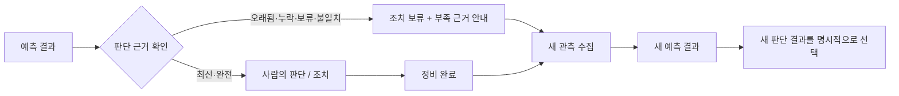
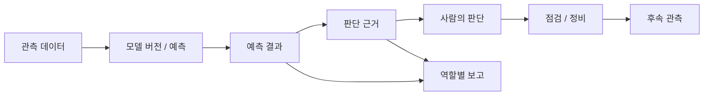

# Ontology Dashboard — 제조 설비 의사결정 지원

설비 이상 가능성 알림을 실제 점검·정비 판단으로 연결하는 제조 운영 지원 프로젝트입니다. **예측 결과 → 판단 근거 → 사람의 검토 → 정비 조치 → 보고**가 같은 설비 이력 안에서 이어지도록 설계했습니다.

팀 프로젝트이며, 저는 **백엔드 판단 근거·동적 보고** 영역에서 실행 중 생성되는 결과·근거와 AI 설명·보고의 검증 규칙을 맡았습니다. 팀 구현 뒤 개인 포크에서는 “불완전하거나 오래된 운영 근거를 조치 판단에 그대로 쓰지 않는다”는 안전장치를 보강했습니다. 이 README는 팀 시스템의 구조와 개인 포크에서 확인한 범위를 구분해 설명합니다.

## 실제 서비스 흐름

<p align="center">
  
</p>

> 로컬 시연 녹화 · 2026-10-12 · 로그인 → 확인이 필요한 설비만 보기 → 위험 설비 선택 → 상황·데이터 연동 상태 확인 → 조치 목록 → 사람 검토

> 리팩터링된 화면을 브라우저에서 직접 녹화한 시연입니다. 실제 공장 운영, 외부 AI 제공자 품질, 실사용 승인 성과를 증명하는 자료는 아닙니다.

## 프로젝트 요약

| 항목 | 내용 |
| --- | --- |
| 해결하려는 문제 | 위험 점수만으로는 현장 담당자가 왜 점검해야 하는지와 어떤 조치가 필요한지 판단하기 어려움 |
| 처리 흐름 | 관측 데이터 → 예측 결과 → 판단 근거 → 사람 검토 → 점검·정비 → 보고 |
| 핵심 원칙 | 역할별 화면과 AI 설명이 같은 설비·같은 시점의 근거를 공유 |
| AI의 역할 | 사람의 판단을 대신하지 않고, 확인 가능한 근거를 설명과 보고로 정리 |
| 팀 구성 | 모델 개발 / 백엔드 판단 근거·보고 / 운영 흐름 / 화면·연동의 네 책임 영역 |

## 개인 포크 보강: 불완전 근거를 판단으로 승격하지 않기

예측 결과가 있어도 관측 시점이 오래됐거나, 근거 누락·품질 보류·설비 불일치·정비 이력 누락이 있으면 사람에게 새 조치를 제안하면 안 됩니다. 개인 포크에서는 이 상태를 숨기거나 AI 문장으로 메우지 않고, **조치를 보류한 이유와 다음에 필요한 관측 정보**를 보여주도록 보강했습니다.



| 구분 | 팀 시스템 기반 | 개인 포크 보강 |
| --- | --- | --- |
| 판단 입력 | 예측 결과와 판단 근거를 역할별 화면에 연결 | 데이터 시점, 근거 누락, 품질 보류, 설비 일치, 정비 이력을 판단 전에 확인 |
| 근거가 부족한 경우 | 근거가 모자란 입력도 화면에 표시 | 조치를 숨기고, 부족한 데이터와 새 관측 필요 상태를 안내 |
| 정비 후 흐름 | 조치와 후속 관측을 연결 | 정비 완료 → 새 관측 반영 → 새 예측 결과가 이어지는지 격리 환경에서 확인 |
| 화면 전환 | 판단 화면 | 이전 결과를 자동으로 덮어쓰지 않고 `새 판단 결과 확인`을 통해 새 결과를 선택 |

### 개인 포크에서 확인한 범위

| 확인한 항목 | 같은 조건에서의 결과 | 이 결과가 뜻하는 범위 |
| --- | ---: | --- |
| 판단 준비 상태 검사 | 16건 중 16건 통과, 보류해야 할 7건에서 조치 노출 0건 | 고정된 합성 입력으로, 화면과 API의 보류 규칙을 확인 |
| 근거 부족 상황에서 조치 숨김 | 조치가 노출된 경우 48/60건 → 0/60건, 판단 가능한 조치 24/24건 유지 | 원천 기록을 바탕으로 만든 12개 설비 입력과 84개 변형 사례를 같은 조건에서 비교 |
| 정비 이력 연결 누락 탐지 | 12건 중 12건 탐지 | 연결 고리를 의도적으로 뺀 입력에서 누락 여부를 확인 |
| 정비 뒤 최신 결과 연결 | CNC 설비 1회 전체 흐름 통과 | 격리 환경에서 정비 기록부터 새 결과 조회까지 한 번 연결해 확인 |

위 수치는 실제 공장·사용자 비교, 실제 고장 탐지율, 서비스 수준을 뜻하지 않습니다. 원천 기록 기반 사례도 결손 상태를 의도적으로 만든 테스트이므로, 독립 평가자가 만든 정답 데이터 평가를 대신하지 않습니다.

- [원천 기록 기반 조치 보류 비교 근거](./docs/evidence/2026-10-15-solutionlink-source-anchored-safety-ab.md)
- [고정 사례 기반 조치 보류 비교 근거](./docs/evidence/2026-10-15-solutionlink-evidence-aware-safety-ab.md)
- [정비 뒤 최신 결과 연결 측정](./docs/evidence/2026-10-13-solutionlink-overlay-bridge-measurement.md)

## 제품 흐름



핵심은 “AI가 고장을 확정한다”가 아니라, **누가 어떤 근거로 무엇을 판단했고 이후 어떤 조치와 결과가 연결됐는지 추적할 수 있게 하는 것**입니다.

## 역할별 화면

### 설비 엔지니어
- 설비 위험 요인
- 센서·특성값 근거
- 점검 대상
- 모델·데이터 이력

### 운영 담당자
- 검토 대기 건
- 판단 대기
- 생산 영향
- 점검·정비 조치
- 조치 뒤 후속 관측

### 경영진
- 전체 위험 현황
- 생산·재무 영향 추정
- 의사결정 병목
- 보고 준비 상태

모든 화면은 서로 다른 정보를 보여주지만, 같은 설비와 같은 사건의 이력을 기준으로 합니다.

## AI 설명 생성 과정

모든 운영 기록을 언어 모델(LLM)에 넣지 않고, 선택한 사건과 같은 설비·시점의 근거를 먼저 구성한 뒤 필요한 정보만 전달합니다.

```text
예측 결과
      ↓
같은 사건 / 같은 설비 / 같은 시점
      ↓
판단 근거 선택
      ↓
AI 설명 생성
      ↓
내용·범위 검사
      ↓
화면 / 보고서
```

근거가 없거나 검사 기준을 통과하지 못하면 임의의 내용을 채우지 않고, 보류 상태와 부족한 정보를 안내합니다.

## 팀 구현에서 확인한 AI 설명 검증

같은 8개 입력을 각각 15회 사용해, 근거 선택·내용 검사가 포함된 방식 120회와 바로 문장을 생성하는 방식 120회를 비교했습니다.

| 확인 기준 | 근거 선택·내용 검사 포함 | 바로 문장 생성 |
| --- | ---: | ---: |
| 공통 내용 검사를 통과한 후보 반환 | **97/120 (80.8%)** | **25/120 (20.8%)** |
| 통과 비율 차이 | **+60.0%p** | - |
| 처리 시간의 가운데 값 | 22.8초 | 10.2초 |

근거 선택·내용 검사 방식은 역할별 필수 항목과 기록 범위를 확인하고, 기준을 만족하지 못한 후보는 다시 작성하거나 보여주지 않았습니다.

이는 정해진 입력에서 내용 검사 규칙이 작동했는지 확인한 결과입니다. 전체 AI 품질이나 실제 현장 유용성을 뜻하지 않으며, 실제 보전 담당자 사용성 평가는 별도 과제입니다.

- [120회 같은 조건 비교](./docs/eval/final-demo-evidence-20260908/pipeline-ab-summary-ko.md)
- [사전 검토 결과](./docs/eval/final-demo-evidence-20260908/blind-agent-eval-results-ko.md)

## 시스템 구성과 책임

```text
데이터 생성
  ↓
데이터·모델 생성기
- 특성값 / 정답값
- 모델 학습
- 버전이 관리되는 모델 산출물
  ↓
백엔드 실행 환경
- 예측 실행
- 예측 결과 / 판단 근거
  ↓
운영 흐름 관리
- 사람의 판단
- 권장 조치
- 정비 조치
  ↓
화면 / 경영진 보고 / AI 보고
```

각 영역은 서로의 구현 세부 사항에 직접 묶이지 않고, 버전이 관리되는 데이터와 화면·API 약속으로 연결합니다.

## 팀 역할 분담

| 역할 영역 | 책임 |
| --- | --- |
| 모델 개발과 데이터 약속 | 특성값·정답값, 모델 산출물, 재현성 |
| **백엔드 판단 근거·동적 보고** | **실행 결과·판단 근거, 근거 기반 설명, 보고서 검사** |
| 운영 흐름과 피드백 | 사람의 판단, 조치, 정비, 후속 관측 연결 |
| 제품 화면과 연동 | 역할별 화면, 언어 모델 실행 연동, 자동 검사, 배포 |

세부 역할은 [최종 역할 분배 및 실행 계획](./docs/final_team_role_and_step_plan.md)을 참고하세요.

## 로컬 실행

전체 로컬 실행:

```bash
bash scripts/run_local.sh
```

PostgreSQL 기반 실행 환경:

```bash
bash scripts/run_local_live.sh
```

백엔드:

```bash
cd systems/backend
pip install -e ../../ml -e '.[dev]'
uvicorn app.main:app --host 0.0.0.0 --port 8000
```

프론트엔드:

```bash
cd systems/frontend
npm ci
npm test
npm run build
```

## 품질 확인 항목

- 구조 경계 확인
- 데이터 생성기 약속·형식 검사
- 백엔드 예측 결과·판단 근거 검사
- 조치와 후속 관측 연결 API
- 프론트엔드 단위 검사·배포용 빌드
- 브라우저 기반 전체 흐름 검사
- 컨테이너 실행 확인

```bash
python3 systems/verify_architecture.py
```

## 배포 구조

```text
GitHub Actions
      ↓
검사를 통과한 main 코드 버전
      ↓
Mac mini 배포 감시기
      ↓
프론트엔드 / 백엔드 실행 환경
      ↓
Cloudflare Tunnel
```

배포와 운영 상세는 [무료 데모 환경](./docs/deployment/free-demo-stack.md)을 참고하세요.

## 저장소 안내

```text
systems/generator/     특성값·학습·모델 산출물
systems/backend/       예측 실행·제품 API
systems/frontend/      역할별 제품 화면
contracts/             공통 데이터 약속
docs/                  구조·운영·평가 문서
evaluation/            평가 코드와 결과
```

## 현재 한계

- 실제 보전·공정 담당자를 대상으로 한 사용성 평가는 아직 별도 검증이 필요합니다.
- 생산·재무 영향은 실제 회계 손실이 아니라 의사결정용 추정치입니다.
- 언어 모델은 사람의 승인·정비 판단을 대신하지 않습니다.
- 정비 완료 기록만으로 정상 상태를 확정하지 않고 후속 관측과 예측 결과를 다시 확인합니다.

## 문서

- [프로젝트 문서 인덱스](./docs/README.md)
- [시스템 구조](./docs/architecture.md)
- [운영 문서](./docs/operations/README.md)
- [발표 데모 흐름](./docs/presentation-demo-flow.md)
- [구조 결정 기록](./docs/architecture-decisions/README.md)
